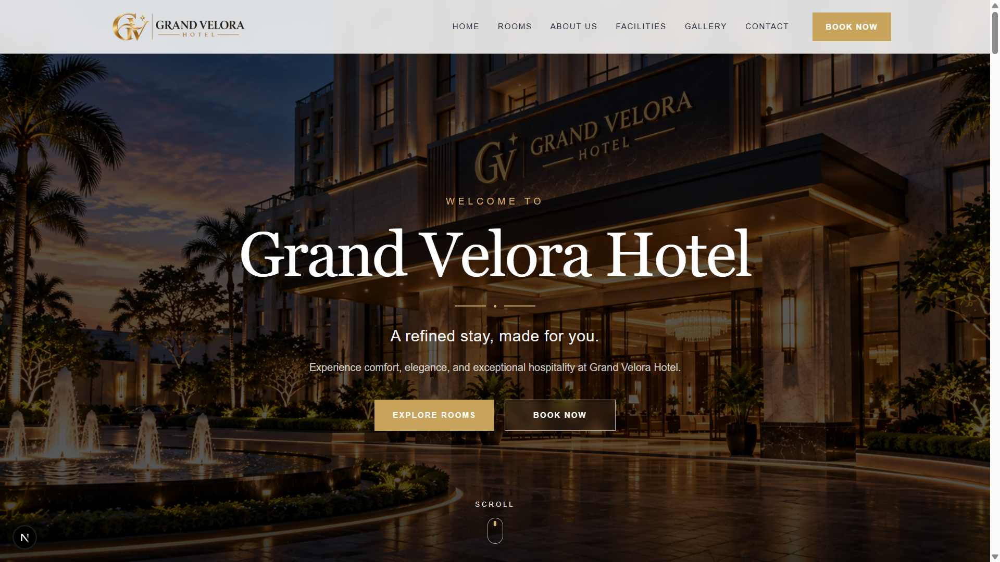
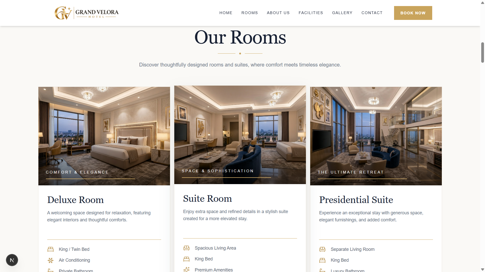
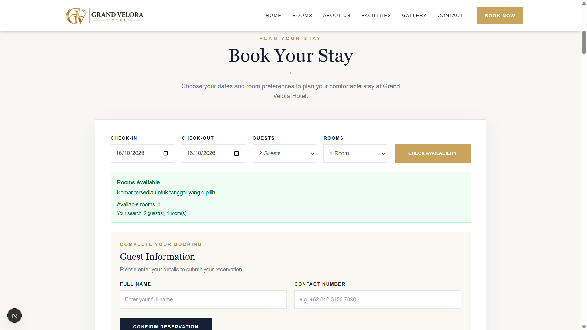
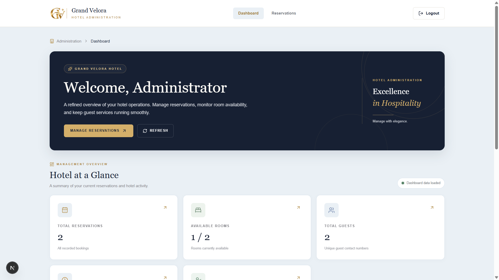
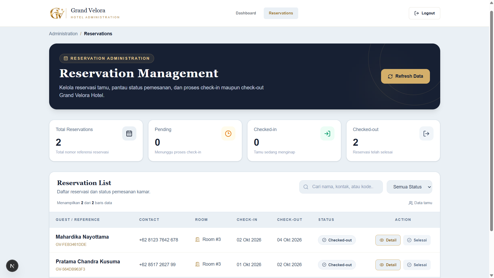

# Grand Velora Hotel

A modern hotel website and reservation management system built with **Next.js, TypeScript, Tailwind CSS, and MySQL**.

Grand Velora Hotel is a web development project designed to provide an elegant hotel browsing experience and a centralized reservation management interface. The project includes a public-facing website and an administrative dashboard for managing guest reservations.

## Preview

### Homepage


### Rooms


### Booking


### Admin Dashboard


### Reservations


## Features

### Public Website
- **Home Page** — A welcoming hero section and hotel introduction.
- **Rooms** — Room information and accommodation options.
- **About Us** — Hotel overview, vision, and mission.
- **Facilities** — Information about hotel facilities and services.
- **Gallery** — A visual showcase of the hotel.
- **Contact** — Hotel contact information and location.
- **Reservation Form** — A booking interface for guests.
- **Room Availability** — An API endpoint for checking room availability.

### Admin Dashboard
- **Admin Authentication** — Login and logout functionality.
- **Dashboard Overview** — A summary of reservation and room information.
- **Reservation Management** — View and search reservation records.
- **Status Filtering** — Filter reservations by their status.
- **Reservation Details** — View guest and booking information.
- **Check-in and Check-out** — Update reservation status through the admin interface.
- **Database Integration** — Retrieve and update reservation data through API routes.

## Tech Stack

- **Framework:** Next.js
- **Language:** TypeScript
- **Styling:** Tailwind CSS
- **Database:** MySQL
- **Runtime:** Node.js
- **Package Manager:** npm
- **Development Tools:** Visual Studio Code and Git

## Project Structure

```text
grand-velora-hotel/
├── app/
│   ├── admin/
│   │   ├── dashboard/
│   │   ├── login/
│   │   └── reservations/
│   ├── api/
│   │   ├── admin/
│   │   ├── availability/
│   │   └── reservations/
│   ├── globals.css
│   ├── layout.tsx
│   └── page.tsx
├── components/
│   ├── About.tsx
│   ├── BookingForm.tsx
│   ├── Contact.tsx
│   ├── Facilities.tsx
│   ├── Footer.tsx
│   ├── Gallery.tsx
│   ├── Hero.tsx
│   ├── Navbar.tsx
│   └── Rooms.tsx
├── lib/
│   ├── admin-auth.ts
│   └── db.ts
├── public/
│   └── images/
├── .gitignore
├── package.json
└── README.md
```

## Getting Started

### Prerequisites

Make sure you have the following installed:

- Node.js
- npm
- MySQL or a compatible local database environment
- Git

### 1. Clone the Repository

```bash
git clone https://github.com/prtmchndr/grand-velora-hotel.git
cd grand-velora-hotel
```

### 2. Install Dependencies

```bash
npm install
```

### 3. Configure Environment Variables

Create a local environment file named `.env.local` in the project root.

Configure the database connection and authentication secrets according to the environment variable names used in `lib/db.ts`, `lib/admin-auth.ts`, and the relevant API routes.

Use your own local credentials and a strong, randomly generated authentication secret. Never commit `.env.local` or expose production credentials in the repository.

### 4. Prepare the Database

Create a MySQL database and configure the required tables according to the application's database schema.

Ensure the database connection settings match your local environment before starting the application.

### 5. Run the Development Server

```bash
npm run dev
```

Open [http://localhost:3000](http://localhost:3000) in your browser.

### 6. Build for Production

```bash
npm run build
```

This command checks whether the application can be built for production. Configure the required environment variables before running it.

## Reservation Statuses

The admin reservation interface uses the following statuses:

| Status | Description |
|---|---|
| Pending | Reservation awaiting check-in processing |
| Checked-in | Guest has checked in |
| Checked-out | Guest has completed the stay |

## Security Notes

- Environment files and credentials must remain private.
- Administrative routes and API endpoints should enforce authentication and authorization.
- Validate booking data and room availability on the server.
- Do not publish real guest information or production database exports.
- Use HTTPS and secure environment variables when deploying the application.

## Project Purpose

This project demonstrates web development using Next.js and TypeScript, database integration, reservation workflows, admin authentication, and responsive user interface development.

It was developed as a continuation of a hotel website project originally built with Laravel and subsequently reimplemented using Next.js.

## Future Improvements

Potential improvements include:

- Automated reservation notifications.
- Reservation confirmation documents.
- Enhanced reporting and analytics.
- Online payment integration.
- Production deployment and monitoring.

## Author

**Pratama Chandra Kusuma**

GitHub: [@prtmchndr](https://github.com/prtmchndr)

---

*Grand Velora Hotel — Elegance, Comfort, Hospitality.*